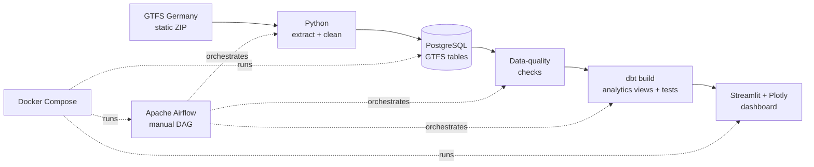

# German Transit Analytics 🚆

**A containerized batch ETL and analytics project for German long-distance railway timetables.**

[](https://github.com/Z3raki444/german-transit-analytics/actions/workflows/ci.yml)

Extract GTFS schedule data, process and validate five relational datasets, build analytics models with dbt, and explore results in a Streamlit dashboard. Designed as a practical data engineering portfolio project.

> **Data scope:** This is a **scheduled-service analytics** application, not a real-time train tracker or a delay-prediction system. The GTFS feed covers the long-distance railway services available in the selected feed, not all transit in Germany.

## Architecture



**Stack:** Python, PostgreSQL 17, Apache Airflow 3.3, dbt/Postgres, Docker Compose, Streamlit, Plotly, SQL.

## What you can explore

- Scheduled departures by station and service date
- Top stations ranked by scheduled departures
- Hourly departure patterns and peak hours
- Service categories and scheduled trip counts
- Interactive station map
- Data quality validation before analytic models are refreshed

**Metric definitions:** A *scheduled trip* is a GTFS journey on a service date; a *scheduled departure* counts eligible timetable departure events at stopping points. Station-date rows are aggregated records, not train journeys or passengers.

## Quick start (Docker Desktop)

**Requirements:** Docker Desktop with Docker Compose and sufficient memory for PostgreSQL, Airflow, and Streamlit. Run the commands below from the repository root.

1. Clone and configure the environment:

   ```powershell
   git clone https://github.com/Z3raki444/german-transit-analytics.git
   cd german-transit-analytics
   Copy-Item .env.example .env
   ```

   Edit `.env` and replace the placeholder with a password used only for local development. **Never commit `.env`.** If you already initialized the database volume, use its *existing* password; changing `.env` does not reset a PostgreSQL role.

2. Build and launch the main services:

   ```powershell
   docker compose config -q
   docker compose up -d --build postgres airflow dashboard
   ```

   On a *fresh* PostgreSQL volume, `sql/init/001_gtfs_schema.sql` creates the required GTFS tables automatically. Docker's PostgreSQL initialization scripts run only when the database directory is empty.

3. Open **Airflow at [localhost:8081](http://localhost:8081)**. To read the standalone admin password locally:

   ```powershell
   docker compose exec airflow cat /opt/airflow/simple_auth_manager_passwords.json.generated
   ```

   Trigger the **`german_transit_etl`** DAG manually and wait for the `build_analytics_models` task to succeed. This downloads the current GTFS feed, loads the tables, checks data quality, and runs `dbt build`.

4. Open the **[Streamlit dashboard at localhost:8501](http://localhost:8501)**.

The source feed is downloaded during the DAG run; generated ZIP/CSV data is intentionally excluded from the repository.

### Useful commands

```powershell
# See services
docker compose ps

# View Airflow logs
docker compose logs --tail=100 airflow

# Test dbt connectivity from the Airflow container
docker compose exec airflow dbt debug --project-dir /opt/airflow/project/dbt --profiles-dir /opt/airflow/project/dbt

# Run dbt models and tests separately
docker compose run --rm dbt build --profiles-dir /usr/app

# Run offline transformation tests
python -m unittest discover -s tests -v
```

## Repository layout

```text
airflow/dags/        Airflow orchestration
src/ingestion/       GTFS download and inspection
src/transform/       GTFS cleaning, calendar expansion
src/load/            PostgreSQL batch loaders
src/quality/         CSV/database checks and referential checks
dbt/models/          Analytics views and model tests
dashboard/           Streamlit and Plotly app
sql/init/            Fresh-database schema initialization
tests/               Offline Python tests
docs/                Architecture and design notes
compose.yaml         Local container orchestration
```

## Data model and limitations

The raw GTFS tables are `stops`, `routes`, `trips`, `stop_times` and `service_dates`. The dashboard reads three dbt models: `daily_station_departures`, `hourly_departures`, and `train_service_summary`.

- The feed's service dates and coverage can change over time.
- Some GTFS stop references may lack matching station metadata; this is reported by the quality check.
- Current route/trip/stop-time loaders use upserts and are not a fully atomic snapshot replacement. Because old timetable records may remain after source changes, the DAG is **manual by design**; unattended daily scheduling requires a safer snapshot-refresh implementation.
- This project does not report measured delays, real-time arrivals, passenger counts, or a national census of all transit services.

See [the architecture notes](docs/ARCHITECTURE.md) for data lineage, design decisions, and future improvements.

## Data source and attribution

Schedule data: [GTFS Germany](https://gtfs.de/), long-distance railway feed (`https://download.gtfs.de/germany/fv_free/latest.zip`). Consult the provider's terms and attribution requirements before redistributing feed data. The repository contains code, **not copies of the downloaded data**.

## Development status

✅ Local end-to-end DAG previously executed successfully (ETL → quality checks → dbt).

✅ Offline calendar transformation tests and repository-level CI checks are included.

🔜 Potential next steps: robust atomic snapshots, scheduled refreshes, more GTFS coverage, and production observability.

### Dashboard image

A dashboard screenshot can be added at `docs/screenshots/dashboard.png` after capturing it from a running local instance. No placeholder screenshot is presented as a real result.
