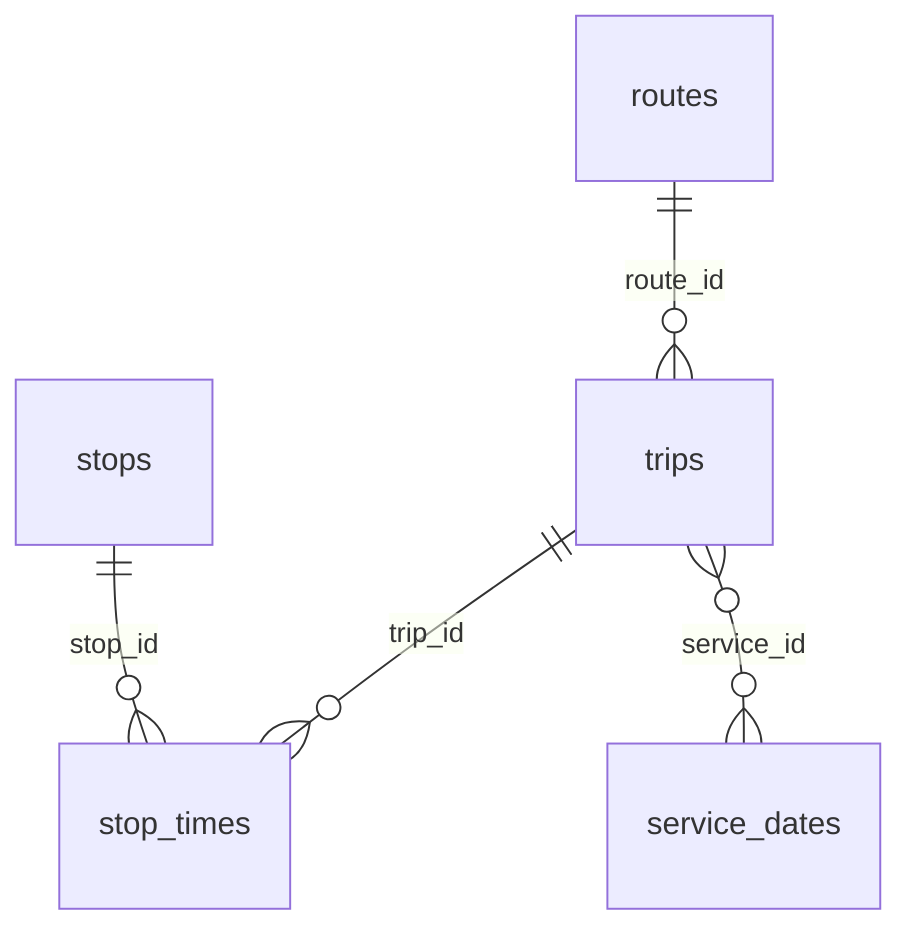

# Data pipeline architecture

## Pipeline stages

1. **Ingestion:** `src/ingestion/extract_gtfs_static.py` downloads a GTFS ZIP to a temporary file, validates its members and CRC, then atomically replaces the local downloaded archive.
2. **Transformations:** Python scripts normalize stops, routes, trips and stop times; `clean_service_calendar.py` expands weekly calendar rules and applies calendar-date additions/removals.
3. **Warehouse:** PostgreSQL stores `stops`, `routes`, `trips`, `stop_times`, and `service_dates` in `public`.
4. **Quality gate:** `check_gtfs_quality.py` compares staged CSV row counts against warehouse row counts and checks orphan trip/route and stop-time/trip relationships. Unmatched stop IDs are reported separately.
5. **Analytics:** Airflow runs `dbt build` only after the quality gate; dbt creates `analytics.daily_station_departures`, `analytics.hourly_departures`, and `analytics.train_service_summary`, and executes dbt tests.
6. **Visualization:** Streamlit queries the PostgreSQL `analytics` views and displays date-filtered metrics, bar charts and a station map.

## Relationships

The relationship from `stop_times.stop_id` to `stops.stop_id` is *logical*: the raw feed may contain unresolved stop references, so it is monitored rather than enforced as a foreign key.

## Scheduling and consistency

The DAG intentionally uses `schedule=None` and `max_active_runs=1`. The current loaders refresh `stops` and `service_dates` while other tables use upserts. Upserts do not remove obsolete records, so a feed update can leave old rows in the warehouse. A future refactor should stage all five GTFS datasets under a snapshot identifier, validate the staged snapshot, then switch all related tables together in one transaction.

The dashboard displays scheduled timetable data, not live performance or delays.

## Running from scratch

`compose.yaml` mounts `sql/init/` into the official PostgreSQL initialization directory. The schema script runs only when Docker initializes a **new** database volume. Existing databases retain their data and can continue working without a reset.

All service passwords are supplied by the untracked `.env` file; do not publish environment values or generated Airflow admin passwords.

## Checks

- Python `unittest` exercises GTFS calendar expansion with synthetic fixture ZIP archives.
- GitHub Actions validates Python syntax, runs offline unit tests, and checks Compose syntax.
- The Airflow quality gate validates loaded data.
- dbt built-in model tests assert non-null identifiers; singular tests detect impossible counts and duplicate station/day keys.

These are complementary checks: GitHub Actions does **not** spin up the complete production-like database and Airflow stack.

## Future upgrades

- Atomic snapshot-based loads and automated schedules
- Dedicated Python package for pure transform functions
- Container/database integration tests
- Metrics, retries, alerting, and historical trend snapshots
